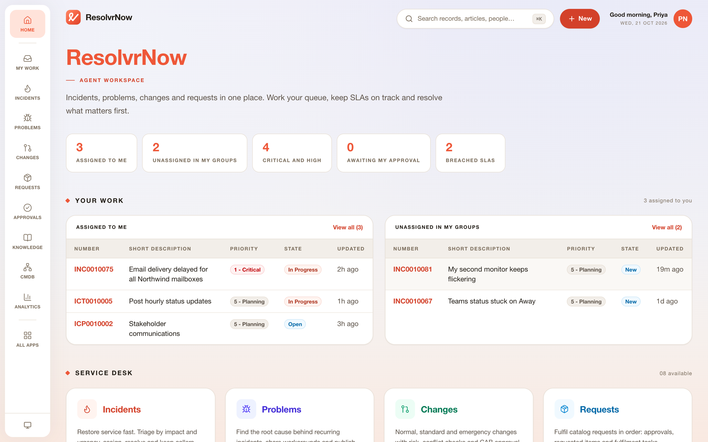

<div align="center">


# ResolvrNow

**Open-source IT service management. Incidents, problems, changes, requests, knowledge, CMDB,
SLAs and AI on one metadata-driven platform, with a REST API your integrations already speak.**

[Website](https://resolvrnow.com) · [Quick start](#quick-start) · [Features](#features) · [API compatibility](#api-compatibility) · [AI](#ai-built-in) · [Architecture](#architecture) · [How it was built](#how-it-was-built)

  



</div>

---

ResolvrNow is a self-hosted ITSM platform for service desks that want the power of an enterprise
service-management suite without the license bill or the lock-in. It is a clean-room
reimplementation of the processes and REST APIs of the market-leading ITSM platform:
- **Your data model and integration scripts keep working.** The table names, fields, encoded
  queries and Table API responses match.
- **The product is yours to run, extend and fork,** under the MIT license.

> ServiceNow is a trademark of ServiceNow, Inc. ResolvrNow is an independent open-source project.
> It is not affiliated with, endorsed or sponsored by ServiceNow, Inc. The name is used only to
> describe API compatibility.

## Quick start

**Docker** (recommended):

```bash
git clone https://github.com/cryptomemeindexer/resolvrnow
cd resolvrnow
docker compose up -d
```

Then open http://localhost:8080.

**Node.js 22+**:

```bash
npm ci
npm run build
RESOLVRNOW_DEMO=true RESOLVRNOW_ADMIN_PASSWORD=change-me npm start
```

`RESOLVRNOW_DEMO=true` loads the fictional company *Northwind Labs*: 26 people, 10 support groups,
CIs, incidents, problems, changes, catalog items, knowledge articles and dashboards. Sign in as:

| User | Role | Password |
|---|---|---|
| `admin` | Administrator | value of `RESOLVRNOW_ADMIN_PASSWORD` |
| `priya.nair` | Service desk manager (incident and major incident manager) | `demo1234` |
| `alex.rivera` | Service desk agent | `demo1234` |
| `grace.okafor` | Change manager | `demo1234` |
| `olivia.martin` | Employee (self-service portal) | `demo1234` |

## Features

| Area | What you get |
|---|---|
| **Incident management** | Impact × urgency priority matrix, assignment and reassignment tracking, on-hold reasons, resolve/close/reopen, auto-close, incident tasks, parent/child incidents, major incident management |
| **Problem management** | Assess → root cause analysis → fix lifecycle, known errors, workarounds pushed to linked incidents, problem tasks |
| **Change management** | Normal, standard and emergency changes with enforced state models, risk assessment, CAB approvals, conflict detection (CIs, maintenance and blackout windows), change tasks, change calendar, pipeline (DevOps) API |
| **Request management** | Service catalog with variables, cart and checkout, requests, requested items and fulfillment tasks, approvals, record producers |
| **Knowledge** | Knowledge bases with review and publish workflows, versions, ratings and feedback, user-criteria access, ranked full-text search |
| **CMDB** | CI class hierarchy, relationships, dependency maps, impact analysis, identification and reconciliation, health scores |
| **SLAs** | Response and resolution SLAs on business schedules, pause/resume/reset conditions, breach warnings |
| **On-call** | Rotations and rosters, escalation policies, "who's on call" |
| **Approvals and flows** | Any/all/first-response/percentage approval rules, delegation, record-triggered flows with approvals, waits and branching |
| **Notifications** | Event- and condition-driven email with templates and `${field}` substitution, SMTP or log transport, inbound email that threads replies |
| **Analytics** | Reports (bar, pie, trend, pivot, single score, list), dashboards, an ITSM KPI catalogue with daily snapshots |
| **Platform** | Users, groups, roles with containment, row- and field-level ACLs, dictionary, choice lists, business rules, UI policies and actions, audit history, activity streams, attachments, sandboxed server-side scripting |
| **Workspace and portal** | A fast React agent workspace (lists, filters, forms, activity, ⌘K search) and an employee self-service portal |

## API compatibility

ResolvrNow implements the REST APIs that integrations, scripts and migration tools commonly rely on:

| API | Paths |
|---|---|
| Table API | `GET/POST /api/now/table/{table}`, `GET/PUT/PATCH/DELETE /api/now/table/{table}/{sys_id}` (also `/api/now/v1`, `/api/now/v2`) |
| Aggregate API | `GET /api/now/stats/{table}` |
| Attachment API | `/api/now/attachment`, `/file`, `/upload`, `/{sys_id}/file` |
| Import Set and Batch | `/api/now/import/{staging_table}`, `/api/now/batch` |
| CMDB | `/api/now/cmdb/instance/{class}`, `/api/now/cmdb/meta/{class}` |
| Service Catalog | `/api/sn_sc/servicecatalog/...` |
| Change Management | `/api/sn_chg_rest/change/...` |
| Knowledge | `/api/sn_km_api/knowledge/...` |

```bash
curl -u priya.nair:demo1234 \
  "http://localhost:8080/api/now/table/incident?sysparm_query=active=true^priority=1^ORDERBYDESCsys_created_on&sysparm_fields=number,short_description,assigned_to&sysparm_display_value=true&sysparm_limit=5"
```

Supported features:
- **Encoded queries:** `^`, `^OR`, `^NQ`, dot-walking (`caller_id.department.name=Finance`), `LIKE`/`STARTSWITH`/`IN`/`BETWEEN`/`ON`/`RELATIVE*`/`DYNAMIC`/`INSTANCEOF`, `javascript:gs.*` date and user macros, `ORDERBY`/`ORDERBYDESC`/`GROUPBY`.
- **Responses:** all three `sysparm_display_value` modes, `sysparm_fields`, `sysparm_exclude_reference_link`, `X-Total-Count` and `Link` pagination, and the platform's error format.
- **Auth:** HTTP Basic, bearer API tokens, and browser sessions with an `X-UserToken` CSRF header.

**Check compatibility yourself.** `npx tsx server/compat/run.ts` runs a differential suite against
your own reference instance and a ResolvrNow server, and writes a report (see
[`server/compat/run.ts`](server/compat/run.ts)).

**Migrating?** `npx resolvrnow import --from https://your-instance --user ... --password ...`
copies users, groups, CIs, knowledge, catalog, incidents, problems and changes through the Table
API, keeping `sys_id`s.

## AI built in

- **Predictive intelligence, local and private.** TF-IDF and Naive Bayes classifiers trained on
  your history predict category, assignment group and priority on new tickets. Similarity search
  finds related incidents and knowledge, and clustering surfaces problem candidates. No external
  service.
- **Generative assist (optional).** Set `ANTHROPIC_API_KEY` to get incident summaries, resolution
  notes, reply drafts, knowledge drafts from resolved incidents, change risk explanations and
  grounded Q&A over your knowledge base. Every skill has a deterministic offline fallback.
- **MCP server.** AI agents (Claude Desktop, Claude Code, any MCP client) can search, create and
  update tickets, look up CIs and query knowledge, with the same ACLs as people. See
  [`docs/mcp.md`](docs/mcp.md).
- **Virtual agent.** A chat assistant in the portal for reporting issues, checking ticket status
  and searching knowledge.

## Architecture

```
web/            React 19 + Vite + Tailwind: agent workspace, employee portal
server/
  src/engine/   metadata-driven platform: schema registry (table inheritance), SQLite storage,
                encoded-query parser/compiler/matcher, records, business rules, ACLs,
                numbering, audit & journal, events, scheduler
  src/modules/  applications: platform, task, incident, problem, change, catalog, knowledge,
                cmdb, asset, sla, schedules, oncall, approvals, flow, notifications, scripts,
                portal, ai, analytics
  src/api/      platform-compatible REST APIs (/api/now/...) and workspace APIs (/api/app/...)
docs/spec/      behaviour specifications (with acceptance tests)
docs/reverse-engineering/   how the target was studied, evidence ledger, tooling
```

- **One synchronous engine.** All modules share it: business rules run before and after writes,
  inside one SQLite transaction (WAL mode). The engine handles about 6,000 inserts per second,
  including rules, numbering and audit.
- **Table-per-hierarchy storage.** `incident`, `problem` and `change_request` rows live in `task`,
  and every CI class lives in `cmdb`. That makes polymorphic queries and references cheap.
- **Modules declare everything as data.** Tables, choices, roles, ACLs, rules, events, jobs,
  navigation, forms, lists, UI actions and UI policies are mirrored into `sys_*` tables, so admins
  can inspect and toggle them.
- **Server-side scripts** run in a QuickJS WebAssembly sandbox with a familiar
  `GlideRecord`/`gs` API, memory and time limits, and no host access.

Developer guide: [`docs/dev/modules.md`](docs/dev/modules.md).

## Configuration

| Variable | Default | Purpose |
|---|---|---|
| `PORT` | `8080` | HTTP port |
| `RESOLVRNOW_DATA_DIR` | `./data` | Database and attachments location |
| `RESOLVRNOW_ADMIN_PASSWORD` | random, printed on first start | Password for the built-in `admin` |
| `RESOLVRNOW_DEMO` | `false` | Load Northwind Labs demo data on first start |
| `RESOLVRNOW_MODULES` | all | Comma-separated module ids to boot (dependencies are added automatically) |
| `RESOLVRNOW_PUBLIC_URL` | from request | Base URL used in API links and emails |
| `RESOLVRNOW_SECURE_COOKIES` | `false` | Set `true` behind HTTPS |
| `RESOLVRNOW_SMTP_HOST` / `_PORT` / `_USER` / `_PASS` / `_FROM` | – | Outbound email (set property `resolvr.email.transport=smtp`) |
| `ANTHROPIC_API_KEY` | – | Enables generative AI skills (Claude) |

## Command line

```
resolvrnow serve | demo | password <user> | token <user> | export | import --from <url> | modules
```

## Development

```bash
npm ci
npm run dev                 # API server with reload on :8080
npm run dev:web             # web app with HMR on :5173 (proxies /api)
npm test                    # server test suite
npm run typecheck
```

## How it was built

ResolvrNow was built clean-room with the open-source **[REA](https://github.com/morluto/rea)**
reverse-engineering toolkit:
1. Runtime captures of the public product pages established the capability and edition map.
2. Network evidence revealed the public documentation API, which was read into a private
   research corpus of 3,441 topics.
3. Static analysis of the vendor's MIT-licensed SDK recovered the platform's table schemas.
4. Specifications were written in our own words, with acceptance tests.
5. The finished app was verified with REA browser scenarios.

The method, evidence IDs and tooling are in
[`docs/reverse-engineering/`](docs/reverse-engineering/README.md).

## License

MIT. See [`LICENSE`](LICENSE) and [`THIRD_PARTY_NOTICES.md`](THIRD_PARTY_NOTICES.md).
